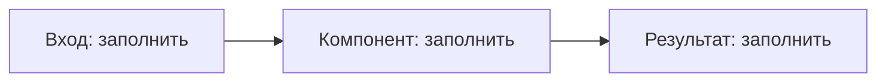

# {{title}}

Возврат: [вставьте полную wikilink-ссылку на ближайшее оглавление].

## Контекст и назначение

[Заполните: реальная задача, пользователи, границы]

## Роль и вклад

[Заполните: личная роль, конкретные действия, что делали другие]

## Стек

[Заполните: фактически использованные технологии и версии]

## Архитектура и потоки



```text
<вход> -> <компонент> -> <результат>
```

[Заполните: компоненты, владельцы данных, границы доверия и последовательность действий]

## Решения и альтернативы

[Заполните: проблема → варианты → выбор → компромисс → доказательство]

## Сложности

[Заполните: диагностика, устранение, проверка]

## Результаты и ограничения

[Заполните: измеренные результаты с источником, датой и методом; неизвестное оставить неизвестным]

## Рассказ для интервью

| Вопрос | Ответ |
| --- | --- |
| [Заполните: вопрос о работе или проекте] | [Заполните: ответ] |

## Сверка с резюме

[Заполните: утверждение → подтверждающий исходник/артефакт → ограничения публикации]
[Заполните: это поля заметки; резюме автоматически не изменяется]

## Ссылки и документы

Git: [Заполните: проверенная ссылка репозитория]
Drive folder reference: [Заполните: проверенная приватная ссылка папки]
Native Docs master: [Заполните: ссылка единственного редактируемого документа]
