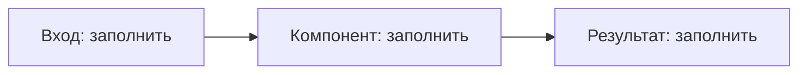

# {{title}}

[[работа/работа|← Работа]]

## Контекст и назначение

{{реальная задача, пользователи, границы}}

## Роль и вклад

{{личная роль, конкретные действия, что делали другие}}

## Стек

{{фактически использованные технологии и версии}}

## Архитектура и потоки



```text
<вход> -> <компонент> -> <результат>
```

{{компоненты, владельцы данных, границы доверия и последовательность действий}}

## Решения и альтернативы

{{проблема → варианты → выбор → компромисс → доказательство}}

## Сложности

{{диагностика, устранение, проверка}}

## Результаты и ограничения

{{измеренные результаты с источником, датой и методом; неизвестное оставить неизвестным}}

## Рассказ для интервью

| Вопрос | Ответ |
| --- | --- |
| {{вопрос о работе или проекте}} | {{ответ}} |

## Сверка с резюме

{{утверждение → подтверждающий исходник/артефакт → ограничения публикации}}
{{это поля заметки; резюме автоматически не изменяется}}

## Ссылки и документы

Git: {{проверенная ссылка репозитория}}
Drive folder reference: {{проверенная приватная ссылка папки}}
Native Docs master: {{ссылка единственного редактируемого документа}}
